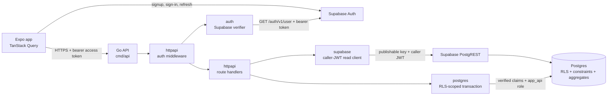

# PersonalExpendiure — Architecture (v1)

Status: draft, v1 scope agreed through design interview.
Last updated: 2026-10-14

Companion to [`REQUIREMENTS.md`](./REQUIREMENTS.md). When they disagree, that
document wins on intent and this one wins on mechanism. The 2026-10-14 pass
aligns the two.

---

## 1. Overview

A multi-tenant expense tracking app. Each person tracks their own expenses, and
groups of friends share costs inside a **Period** — a named, time-bounded shared
space (a trip, a semester, a term in a shared flat).

Two things define the product:

1. **Personal tracking** — expenses, flat categories, monthly budgets, monthly
   reports.
2. **Shared periods** — several people record costs into the same period; the
   app works out who owes whom.

### Core principles

These are the rules the rest of the document follows from. If a change violates
one of these, the change needs an explicit decision.

- **Go owns application workflows; Postgres owns data enforcement and
  aggregates.** Go performs authoritative server-side request validation and
  orchestrates application operations. Postgres enforces RLS, database
  constraints, and atomic integrity, and computes balance, budget, and report
  aggregates. TypeScript validation is for UX only. The phone is a cache and a
  renderer.
- **Tenant isolation is enforced in the database**, via Row Level Security, not
  in application code.
- **Money is never a float.** Every amount is an integer count of minor units
  (cents) paired with an ISO-4217 currency code.
- **Splits are stored as computed results, not as rules.** A share amount is
  frozen at creation time, so history never changes meaning.
- **Deleted means hidden, not erased.** Expenses, periods, and budgets are
  soft-deleted (`deleted_at`). Categories are archived. The only hard erase is
  account deletion of *personal* data; shared ledger rows survive as a
  tombstone (FR-1.7).
- **Validate on the server, always.** The client is not trusted, including the
  client's own app.

---

## 2. v1 scope

### 2.1 Accounts and access

- Email + password signup, email verification, password reset, logout.
- **Unverified accounts cannot be used (FR-1.2).** Supabase requires a confirmed
  email before issuing a usable session. RLS and Go write workflows also refuse
  callers without a live profile linked to the verified Auth identity.
- Sessions: Supabase JWT + refresh tokens in device secure storage.
- Onboarding: a single screen asking for base currency, then confirming starter
  categories. IANA time zone is taken from the device and can be changed in
  settings. No demo data, no auto-created periods.
- Minimal PII: `id`, `email`, optional `display_name`. Nothing else.
- Self-service account deletion (FR-1.7, FR-1.8):
  - Purge personal expenses, personal budgets, and categories.
  - Strip PII from the profile and keep the row as a tombstone so other
    people's shared expenses and splits still resolve `paid_by` / split
    `user_id`.
  - Remove `period_members` rows for this user.
  - **Reject** deletion if the user is still manager of any period — they
    transfer the role or delete the period first.

### 2.2 Personal expenses

- Create / edit / soft-delete an expense: amount, date, category, optional note.
  Amount edits rewrite the single owner split in the same RPC.
- Flat categories per user (seeded, editable, reorderable, archivable).
- Browse and filter: by month, by category, text search on note.
- Monthly budgets: personal (whole-scope or per category) or period
  (whole-scope only in v1). Each budget row is for one calendar month.
- Reports: month total, breakdown by category, spend per day, budget progress.

### 2.3 Periods (shared)

- A Period has a name, a manager, a start date, and an optional end date
  (`NULL` = ongoing).
- **Fixed roster.** Members are added when the Period is created, by exact
  email match inside `create_period()` — never by listing `profiles`. There is
  no invite, join, or accept flow in v1.
- Any member can create an expense in the Period.
- Author chooses how each expense is divided: equal among everyone by default,
  or exclude specific members (omit a split row), or type exact amounts per
  person.
- Shared expenses have `category_id IS NULL`. Period reports have no category
  breakdown in v1.
- Balances screen: for each member, total paid, total owed, net.
- Permission model:

| Action | Member, own expense | Member, another's expense | Manager |
| --- | --- | --- | --- |
| Create | yes | yes (into their period) | yes |
| Edit date / note | yes | no | yes |
| Edit amount / splits | no (delete and recreate) | no | no (delete and recreate) |
| Delete (soft) | yes | no | yes |

- Manager can transfer the role. The last manager cannot leave, be removed, or
  delete their account until they transfer or delete the period.
- Manager can soft-delete the period. That sets `deleted_at` on the period and
  on its expenses and budgets. Members stop seeing it; rows are not hard-erased.

### 2.4 Import / export

- CSV export of transactions for a date range (human-readable).
- JSON full backup, versioned via `schema_version`, covering periods, members,
  expenses, splits, budgets, and categories as nested structures.

### 2.5 Application API and request flow

- All authenticated application data requests go through the Go API. The mobile
  app signs in and refreshes sessions with Supabase Auth, then sends the current
  Supabase access token to the API as a bearer token.
- The current Go API scaffold validates each bearer token through Supabase
  Auth's `GET /auth/v1/user` endpoint and derives the caller ID only from that
  verified response. It does not trust an unverified JWT claim or a user ID
  supplied in a request body or URL. This adds an Auth request to protected API
  calls; the verifier is behind an interface so a locally verified JWKS
  implementation can replace it after signing-key support and rotation are
  confirmed for the deployed Supabase project.
- For database reads, the API forwards the caller's JWT to Supabase/PostgREST.
  For Go-owned writes, it opens a transaction, installs claims from the
  verified caller, and switches to the restricted `app_api` database role
  before issuing queries. RLS therefore evaluates each operation as the caller.
  The Go code must never issue user queries outside that scoped transaction.
- The API provides transport, authentication verification, authoritative
  application-rule validation, request/response mapping, and integration
  orchestration. It does not calculate balances, reports, or budgets. Database
  constraints and transactional write checks remain as integrity safeguards;
  they do not replace Go's API-level validation.
- Supabase Auth remains the authority for account credentials and sessions.
  Signup, email verification, password recovery, and token refresh use Supabase
  Auth; protected application data is accessed through the Go API.
- The implemented expense routes include `GET /v1/expenses` and
  `POST /v1/expenses`. Reads use a fixed PostgREST query under the caller's JWT;
  writes use a verified-identity transaction under `app_api`. `amount_minor`
  is encoded as a decimal string at the mobile API boundary to preserve
  PostgreSQL `bigint` precision in JavaScript.

### 2.6 Offline behaviour

- Reads are served from the TanStack Query cache, **persisted on device**
  (e.g. MMKV) so a cold start can render last-known data (FR-10.1, NFR-3).
- Offline banner: "showing data from *time*".
- Writes require a connection and fail loudly. No write queue, no local
  database in v1.

---

## 3. Out of scope (v1)

Kept as an explicit, maintained list. Many of these are additive later by design
— the notes say which.

**Platform**
- Web app, desktop app. (React Native + Expo only.)

**Money**
- Multi-currency conversion and FX rates. Users have one base currency; each
  Period has one currency. *(Additive: every amount already carries a currency
  code, so this is a new column on new records, not a migration.)*
- Refunds and negative amounts.
- Transfers between own accounts. Every record in v1 is an expense.
- Mid-month budget cycles. *(Additive: one nullable column.)*

**Expenses**
- Receipt photo capture and object storage.
- Recurring / scheduled expenses.
- Split types beyond equal and exact: percentage, "N shares", proportional.
  *(Additive: split amounts are already stored as computed values.)*
- Split edits after creation. Amount and splits on a shared expense are
  immutable; delete and recreate instead (FR-5.10).
- Categories on shared expenses, and period budgets scoped to a category.

**Periods**
- Invite / join / accept flows; members joining or leaving on their own.
- Settle-up minimisation ("who pays whom to zero out in fewest transactions").
- Recording repayments between members.
- Period templates.

**Platform services**
- Push notifications, over-budget alerts, period invitations.
- OAuth / social login, magic-link passwordless login.
- Analytics and telemetry (decision still open — see §9).
- In-app payments or subscriptions.

**Sync**
- Offline write queue. *(Additive: every expense carries a client-generated
  UUID, so replay can be made idempotent later.)*
- Conflict resolution beyond last-write-wins.

**Categories**
- Sub-categories / nested trees. *(Deferred in favour of a `category_groups`
  table that groups existing flat categories without touching history.)*

**Infrastructure**
- Multi-region, backups automation, disaster recovery runbook.
- Admin dashboards and support tooling.
- A second backend service or microservice beyond the single Go API.

---

## 4. Tech stack and why

| Layer | Choice | Why this and not the alternative |
| --- | --- | --- |
| Client | **React Native + Expo (TypeScript)** | Over Flutter: Over-the-Air updates. For a v1 that will ship bugs in money math, patching JS the same day without store review is worth more than pixel-identical rendering. |
| Navigation | **Expo Router** (file-based) | Default in new Expo apps; no navigation config file to drift out of sync. |
| Server state | **TanStack Query** | The query cache *is* the offline-read story. Over Redux: avoids hand-maintaining a normalised expense cache that duplicates the database. |
| Local UI state | **Context / Zustand (minimal)** | Holds only current month, dismissed onboarding, similar. Never server data. |
| Application API | **Go, one stateless HTTP API for v1** | Owns application workflows and authoritative request validation, provides a stable API boundary, validates Supabase access tokens, and preserves the end-user identity for database access so RLS remains effective. It does not replace Supabase Auth. |
| Backend data services | **Supabase managed Postgres + Auth** | Managed Auth handles credentials, verification, recovery, and sessions; Postgres and RLS remain authoritative for persistence and tenant isolation. |
| Database enforcement and aggregates | **Postgres RLS, constraints, transactions, functions + views** | RLS protects tenant data; constraints and transactions preserve persisted integrity; SQL owns balance and report aggregates. Go owns application workflows and server-side request validation. |
| Email | **Resend or Postmark** | **Not** Supabase's built-in SMTP: it is rate-limited to roughly 2 emails/hour on the free tier, which breaks signup and password reset in ways users experience as "the app is broken". |
| Auth method | **Email + password** | Over OAuth: no custom URL scheme or associated-domain setup to debug in Expo. App Store rule 4.8 (Sign in with Apple) applies only if a third-party login is offered. Email + password alone does not require it. |
| Testing | **Go tests + Jest (jest-expo) + Supabase local stack + pgTAP** | Go tests cover API behavior; Jest covers pure TypeScript helpers; local Supabase and pgTAP prove real RLS and database behavior. |
| CI/CD | **GitHub Actions + EAS Build + EAS Update** | CI checks the Go API, mobile app, and database migrations. EAS manages signing and store submission. Hosted builds are reversible — `expo prebuild` remains available. |
| Lint/format | **Biome, or ESLint + Prettier** | Either is fine; pick one and don't churn. |

### Release order

1. **Android first.** Sideloading via EAS is free and installs the same day.
2. iOS requires a paid Apple Developer account ($99/yr) plus App Store review
   (~1–3 days). The OTA channel is the only fast lane for fixes.

---

## 5. Data model

All timestamps are `timestamptz` in UTC. All dates are `date` (no time, no
zone). All amounts are `bigint` minor units.

The initial migrations implement the profile, category, period-membership,
expense, and split tables. The current Go API supports personal expense reads
and personal/shared expense creation; write workflows are in Go, with RLS and
database integrity safeguards in Postgres.

### 5.1 Tables

#### `profiles`
One row per user, created by a trigger on `auth.users`. The profile id is the
stable public identity. Auth can go away without deleting shared history.

| Column | Type | Notes |
| --- | --- | --- |
| `id` | `uuid` PK | Public identity. FKs from expenses and splits point here. |
| `auth_user_id` | `uuid` | → `auth.users(id)` `ON DELETE SET NULL`. Unique while set. Null on a tombstone. |
| `email` | `text` | Null on a tombstone. |
| `display_name` | `text` | nullable; null on a tombstone |
| `base_currency` | `char(3)` | nullable until onboarding; then ISO-4217. Every personal amount uses this. |
| `timezone` | `text` | IANA, e.g. `Europe/Berlin`. Used in v1 for "today" and month bounds. |
| `deleted_at` | `timestamptz` | nullable — set when the account is deleted (tombstone) |
| `created_at` / `updated_at` | `timestamptz` | |

#### `categories`
| Column | Type | Notes |
| --- | --- | --- |
| `id` | `uuid` PK | |
| `user_id` | `uuid` | → `profiles(id)` `ON DELETE CASCADE` |
| `name` | `text` | unique per user, case-insensitive |
| `icon`, `color` | `text` | nullable |
| `sort_order` | `int` | |
| `is_archived` | `bool` | archived categories stay referenced by old expenses |

Indexes: unique `(user_id, lower(name))`; `(user_id, sort_order)`.

#### `periods`
| Column | Type | Notes |
| --- | --- | --- |
| `id` | `uuid` PK | |
| `name` | `text` | |
| `manager_id` | `uuid` | → `profiles(id)` — denormalised cache of the manager. `period_members.role` is authoritative. `transfer_manager()` updates both in one transaction. |
| `starts_on` | `date` | |
| `ends_on` | `date` | nullable — `NULL` means ongoing |
| `currency` | `char(3)` | single currency for the whole period |
| `deleted_at` | `timestamptz` | nullable — manager-deleted period (FR-4.8) |
| `created_at` / `updated_at` | `timestamptz` | |

Check: `ends_on IS NULL OR ends_on >= starts_on`.

The partial unique index on `period_members` gives **at most** one manager.
`create_period()` requires **at least** one. Together: exactly one live manager
on a live period.

#### `period_members`
| Column | Type | Notes |
| --- | --- | --- |
| `id` | `uuid` PK | |
| `period_id` | `uuid` | → `periods(id)` — no cascade from profile deletion |
| `user_id` | `uuid` | → `profiles(id)` `ON DELETE RESTRICT` |
| `role` | `enum('manager','member')` | authoritative manager flag |
| `joined_at` | `timestamptz` | |

Constraints:
- `UNIQUE (period_id, user_id)`
- Partial unique index on `(period_id)` **where `role = 'manager'`** — at most
  one manager per period.
- Index `(user_id)` for "my periods".
- Roster changes (add/remove) are not in v1. Account deletion removes the
  membership row via `delete_account()`, after FR-1.8 is satisfied. The last
  manager cannot be removed.

#### `expenses`
The central table. A row is either **personal** (`period_id IS NULL`) or
**shared** (`period_id IS NOT NULL`). Everything below works for both.

| Column | Type | Notes |
| --- | --- | --- |
| `id` | `uuid` PK | **client-generated** — enables idempotent create and an offline queue later |
| `user_id` | `uuid` | author / creator. Also the owner for personal expenses. → `profiles(id)` `ON DELETE RESTRICT` (tombstone keeps the row). |
| `period_id` | `uuid` | nullable |
| `category_id` | `uuid` | nullable. **v1: must be NULL when `period_id` is set.** Personal expenses should set a category. |
| `paid_by` | `uuid` | for personal rows this must equal `user_id`. → `profiles(id)` `ON DELETE RESTRICT`. |
| `amount_minor` | `bigint` | `CHECK (amount_minor > 0)` |
| `currency` | `char(3)` | v1: equals the user's base currency, or the period's currency |
| `occurred_on` | `date` | accounting date, no time zone |
| `note` | `text` | nullable |
| `deleted_at` | `timestamptz` | nullable — soft delete |
| `created_at` / `updated_at` | `timestamptz` | `created_at` is never shown in the UI |

Check:
```sql
CHECK ((period_id IS NULL AND paid_by = user_id)
    OR (period_id IS NOT NULL AND paid_by IS NOT NULL AND category_id IS NULL))
```

Currency: a trigger (not a comment) requires `currency` to equal the owner's
`base_currency` when `period_id` is null, or the period's `currency` otherwise.

Indexes: `(period_id, occurred_on DESC)` where `deleted_at IS NULL`;
`(user_id, occurred_on DESC)` where `period_id IS NULL AND deleted_at IS NULL`.

#### `expense_splits`
One row per participant. **The split result, not the split rule.**

| Column | Type | Notes |
| --- | --- | --- |
| `id` | `uuid` PK | |
| `expense_id` | `uuid` | → `expenses(id)` `ON DELETE CASCADE` |
| `user_id` | `uuid` | participant → `profiles(id)` `ON DELETE RESTRICT` |
| `amount_minor` | `bigint` | `CHECK (amount_minor > 0)` — excluded members get **no row**, not a zero share |
| `created_at` | `timestamptz` | |

Constraints:
- `UNIQUE (expense_id, user_id)`
- Index `(user_id)` for `owes_minor`.
- **Invariant: `SUM(amount_minor) == expenses.amount_minor`** for every expense.
  Enforced by a deferred database trigger; asserted in tests.

A personal expense has exactly **one** split row: its owner, for the full
amount. This unifies the balance query — there is no separate code path for
"personal" versus "shared".

#### `budgets`
One row per scope per calendar month (and per category, when set). Not a
repeating template — creating next month's budget is a new row.

| Column | Type | Notes |
| --- | --- | --- |
| `id` | `uuid` PK | |
| `scope_type` | `enum('user','period')` | |
| `user_id` | `uuid` | nullable; set iff `scope_type = 'user'` |
| `period_id` | `uuid` | nullable; set iff `scope_type = 'period'` |
| `category_id` | `uuid` | nullable — `NULL` means whole-scope. Must be NULL when `scope_type = 'period'` (v1). |
| `month_start` | `date` | first day of the calendar month this budget applies to. `CHECK (EXTRACT(DAY FROM month_start) = 1)` |
| `amount_minor` | `bigint` | `CHECK (amount_minor > 0)` |
| `deleted_at` | `timestamptz` | nullable |
| `created_at` / `updated_at` | `timestamptz` | |

Check enforcing exactly one scope:
```sql
CHECK ((scope_type = 'user'   AND user_id IS NOT NULL AND period_id IS NULL)
    OR (scope_type = 'period' AND period_id IS NOT NULL AND user_id IS NULL
        AND category_id IS NULL))
```

Unique: `(scope_type, user_id, period_id, category_id, month_start)` where
`deleted_at IS NULL`.

Cycle: **calendar month**, 1st to last, in the relevant zone (user timezone for
personal; still passed as `(from, to)` dates). Budgets are **soft warnings** —
the app never blocks recording an expense.

### 5.2 Application rules (Go) and database enforcement

Application workflows and request validation live in Go. Postgres functions
remain appropriate for RLS helpers and aggregate queries; database constraints,
grants, policies, and triggers protect persisted integrity. `app_api` is a
non-login role that inherits the authenticated user's permitted reads and has
narrow expense/split insert grants. A separate `app_api_login` role is
provisioned with a secret outside migrations and can only assume `app_api`.
RLS helpers such as `is_live_period_member(uid, pid)` remain database functions
to avoid recursive policy checks.

#### Expense writes (Go workflow + Postgres safeguards)
`POST /v1/expenses` is implemented in `backend/internal/postgres/expenses.go`.
Go authenticates the request through the verified `auth.Session`, validates
the payload and business rules, and performs all context reads plus the expense
and split inserts in one transaction. The transaction sets local JWT claims
from the verified Supabase user ID and switches to `app_api`; it never trusts
identity supplied by the request body.

Go checks the caller profile, personal category ownership or period membership,
the period date range and currency, the user's local `today`, the payer and
split participants, positive integer shares, exact split sum, and create
idempotency. RLS limits rows visible to the caller. The mobile-facing
`authenticated` role has no expense/split write grants. A deferred trigger
rejects an expense with no splits or a mismatched sum at transaction commit.

Future update, soft-delete, period, budget, and account workflows belong in Go
and must use equivalent caller-scoped transactions. Database constraints and
RLS remain enforcement safeguards. The old SQL write RPCs are executable only
by `app_api` for existing pgTAP conformance fixtures; the Go API does not call
them and mobile-authenticated clients cannot use them as an alternate write
path. Remove those legacy functions when the fixtures migrate to direct
seed/setup plus Go API assertions.

#### `expense_totals(scope, from, to)`
Report aggregates. Scope is `('user', user_id)` or `('period', period_id)`.
Month boundaries are computed **in the user's zone**, never in UTC, and are
passed as explicit `(from, to)` date ranges — never as a `'2026-03'` string.

#### `period_balances(period_id) → table`
Returns one row per member:

```
paid_minor  = SUM(expenses.amount_minor)  WHERE period = P AND paid_by = m AND not deleted
owes_minor  = SUM(expense_splits.amount_minor) WHERE split.user_id = m AND expense in P AND not deleted
net_minor   = paid_minor - owes_minor      -- positive: m is owed money
```

Balances are **always computed**, never stored or incrementally maintained. A
maintained balance table drifts; a computed one cannot.

### 5.3 Reporting semantics

These rules prevent the classic "why does October say I spent $12,000" bug.

| Report | Includes |
| --- | --- |
| **Personal total** | Only expenses with `period_id IS NULL` owned by me. Counted at **100%**. |
| **My share of shared costs** | Shown separately as a "shared" line, never folded into the personal total. |
| **Period total** | All non-deleted expenses in the period, at **gross** amount, regardless of payer. |
| **Period by category** | Not in v1. Shared expenses have no category. |
| **Period balances** | Gross up for the group, net per member (see §5.2). |

A **personal budget** counts only personal expenses. A **period budget** counts
gross period spend. My share of a shared dinner never counts against my personal
Food budget.

### 5.4 Rounding

Never divide naively. `allocate(amount_minor, n)`:

1. `base = floor(amount_minor / n)` for every participant.
2. Distribute the remaining `amount_minor - base * n` minor units, one each, in
   a **stable deterministic order** (participants sorted by `user_id`).

`1000` across 3 people → `334 / 333 / 333`, always in the same order. This is a
pure function, unit-tested, and used identically on client and server.

### 5.5 Row Level Security

Enabled on every table. The mobile app never uses a service-role key. Read
requests forward the caller JWT. Go writes use the restricted `app_api` role
with verified caller claims set transaction-locally, so Postgres applies the
caller's RLS policies. The application login must not be a RLS-bypass role.

| Table | select | insert | update | delete |
| --- | --- | --- | --- | --- |
| `profiles` | own live row | — (trigger on `auth.users`) | own live row | — (via `delete_account()`) |
| `categories` | own | Go workflow (owner scope) | Go workflow (owner scope) | Go workflow (archive preferred; hard delete rejected if referenced) |
| `periods` | member of a live period | Go workflow | Go workflow (manager) | Go workflow (manager soft-delete) |
| `period_members` | member of that live period | Go workflow | Go workflow (manager transfer) | Go workflow (account deletion only) |
| `expenses` | own personal, **or** member of its live period | Go `app_api` role: caller-owned personal or period member | Go workflow (future endpoint) | Go workflow (future endpoint) |
| `expense_splits` | same as parent expense | Go `app_api` role: caller-created expense only | Go workflow (future endpoint) | with parent |
| `budgets` | own personal, or member of the period for a period budget | Go workflow (owner or period manager) | Go workflow (owner or period manager) | Go workflow (soft delete) |

Live period means `periods.deleted_at IS NULL`. Membership checks go through
`is_period_member(auth.uid(), period_id)`, not a raw subquery, to avoid RLS
recursion.

The expense SELECT policy in full:
```sql
USING (
  (user_id = (SELECT id FROM profiles WHERE auth_user_id = auth.uid() AND deleted_at IS NULL)
   AND period_id IS NULL)
  OR is_period_member(auth.uid(), period_id)
)
```

A former member whose `period_members` row was removed sees **zero** rows from
that period (BR-8). Tombstone profiles are not selectable by their former owner.

Go validates membership, date range, currency, and split participants before
writing. RLS still checks row ownership/membership, table grants prevent the
mobile `authenticated` role from writing expenses or splits directly, and a
deferred database trigger enforces that every expense has at least one split
whose total equals the expense amount.

---

## 6. Module and folder structure

A single repository contains one mobile `package.json` and one Go module under
`backend/`. No JavaScript workspace toolchain is needed in v1.

```
PersonalExpendiure/
├─ app/                          # Expo Router routes (thin — no business logic)
│  ├─ _layout.tsx
│  ├─ (onboarding)/
│  ├─ (tabs)/
│  │  ├─ index.tsx               # this month
│  │  ├─ reports.tsx
│  │  └─ settings.tsx
│  ├─ expense/[id].tsx
│  └─ period/[id]/
│     ├─ index.tsx               # period expenses
│     ├─ balances.tsx
│     └─ budget.tsx
│
├─ src/
│  ├─ db/
│  │  └─ auth.ts                 # Supabase Auth + secure session persistence
│  ├─ api/
│  │  ├─ client.ts               # typed Go API client
│  │  └─ types.ts                # generated from backend OpenAPI contract
│  ├─ features/
│  │  ├─ expenses/               # screens, hooks, components — one folder per feature
│  │  ├─ periods/
│  │  ├─ budgets/
│  │  ├─ reports/
│  │  ├─ categories/
│  │  └─ onboarding/
│  ├─ shared/                    # pure TypeScript, no React, no Supabase imports
│  │  ├─ money/                  # minor-unit parse/format, allocate(), rounding
│  │  ├─ dates/                  # month ranges in a user time zone
│  │  └─ validation/             # client-side mirrors of server rules, for UX only
│  ├─ ui/                        # design system: buttons, inputs, bars, charts
│  └─ lib/                       # query keys, constants, result types
│
├─ backend/                      # Go API; the only application backend in v1
│  ├─ openapi.yaml               # versioned HTTP API contract
│  ├─ cmd/api/                   # process entrypoint and server startup
│  ├─ internal/
│  │  ├─ auth/                   # Supabase token verification and caller identity
│  │  ├─ httpapi/                # routes, auth middleware, handlers, errors
│  │  │  └─ expenses.go          # personal expense list endpoint
│  │  ├─ supabase/               # caller-JWT-forwarding PostgREST read client
│  │  ├─ postgres/               # caller-scoped RLS transactions and writes
│  │  └─ config/                 # runtime configuration
│  ├─ go.mod
│  └─ .env.example               # local configuration names; no credentials
│
├─ supabase/
│  ├─ migrations/                # schema, RLS, integrity triggers, and aggregates
│  ├─ tests/
│  │  ├─ expense_rls_test.sql    # pgTAP — direct RLS coverage for expense reads
│  │  └─ golden_dataset_test.sql # pinned expected balances
│  ├─ seed.sql                   # no invented user or expense data
│  └─ config.toml
│
├─ e2e/                          # Maestro flows — optional, added after v1
├─ .github/workflows/            # ci.yml, migration-check.yml
├─ docs/ARCHITECTURE.md
├─ docs/REQUIREMENTS.md
└─ package.json
```

Rules:
- `app/` routes are thin. Logic lives in `src/features/*`; pure logic in
  `src/shared`.
- `backend/` is a stateless API boundary. It authenticates Supabase JWTs. Reads
  forward caller tokens to PostgREST; writes use a restricted Postgres role and
  transaction-local verified claims so RLS remains effective. Go owns application
  rules; SQL owns constraints, RLS, and aggregates.
- `GET /v1/expenses` sends explicit date filters and pagination to PostgREST;
  the returned rows remain tenant-scoped by RLS. Month bounds are computed by
  the client in the user's IANA time zone, never inferred by the Go API.
- All app data operations go through `backend/`; Supabase Auth client calls from
  `src/db/auth.ts` are limited to signup, verification, sign-in, recovery, and
  session refresh. API requests use the typed client in `src/api/client.ts`.
- `backend/openapi.yaml` is the application API contract; mobile types are
  generated from this contract, not from the database schema.
- `src/shared` imports nothing from `react`, `expo`, or `@supabase/supabase-js`,
  which is what makes it trivially unit-testable.
- `src/api/types.ts` is generated from `backend/openapi.yaml` and never
  hand-edited. Mobile code does not use generated database-schema types because
  it does not call database tables or RPCs directly.

### 6.1 Go API module view

The diagram is Mermaid source stored in this document, so it can be reviewed
and edited as code. Auth requests for signup, sign-in, and refresh stay between
the app and Supabase Auth. Protected application requests go through the Go API;
the API verifies the access token with Auth, forwards it for reads, and installs
the verified identity in a restricted Postgres transaction for writes.



---

## 7. Key decisions and trade-offs

| # | Decision | Alternative rejected | Consequence |
| --- | --- | --- | --- |
| 1 | Mobile-only v1 (RN + Expo) | Web-first PWA, desktop | Half the surface to build and ship. Costs: no link sharing, no desktop reporting. |
| 2 | Expo + RN, not Flutter | Flutter | Gave up cross-platform pixel consistency to get OTA updates — a day-one fix without a store review. |
| 3 | Supabase Auth/Postgres/RLS with one Go application API | Hand-rolled auth or client-owned rules | Supabase owns credentials and Postgres enforces tenant isolation and persisted integrity; Go owns application workflows and authoritative request validation. Cost: another deployable service to operate and secure. |
| 4 | Client-generated UUIDs on expense create | Server-generated ids | Enables idempotent create now and an offline write queue later without a data migration. |
| 5 | One currency per user and per period | Multi-currency with FX | All totals are trivially correct. The currency column already exists, so this is additive later. |
| 6 | Integer minor units | `float` / `numeric` in JS | No cent-level drift, ever. Cost: every amount crosses the JS boundary as a number that must be formatted explicitly. |
| 7 | Freeze computed split amounts; shared amount/splits immutable after create | Store the split rule, or allow in-place split edits | Historical balances never change meaning. Cost: changing a shared split means delete + recreate (FR-5.10). |
| 8 | Equal + exact custom splits | Full Splitwise rule set | Validation is bounded (non-negative, must total exactly). Percentage and "N shares" are pure UI additions later. |
| 9 | Balance and report math in SQL | Compute in TypeScript or Go | One authoritative aggregate implementation; exact golden-dataset tests protect the results. |
| 10 | Go-owned application workflows with database integrity safeguards | SQL-owned application workflows or client inserts | Go rules are readable and testable in the application language; RLS, constraints, and transactions remain the database enforcement boundary. Cost: both API behavior and database safeguards need focused security coverage. |
| 11 | Soft-delete expenses, periods, and budgets; archive categories; tombstone on account delete | Hard delete everywhere, or soft-delete every table | Cached clients see a tombstone instead of a resurrection. Personal data is actually erased on account deletion; shared history is not (FR-1.7). |
| 12 | Last-write-wins, no conflict engine | Optimistic locking / CRDTs | Simplicity. Accepted risk: two simultaneous edits to the same expense silently lose one. Manager-gated deletion keeps the blast radius small. |
| 13 | Cached reads, online-only writes | Full offline-first sync | Avoids a sync protocol entirely. Accepted cost: you cannot record an expense with no signal. |
| 14 | Fixed period roster, no invites | Invite/accept lifecycle | Avoids invite tokens, pending states, "member left" handling, and the "we edited an expense someone already saw" class of bugs. Cost: the manager must know everyone's account up front. |
| 15 | Manager role with transfer | Manager as permanent creator | No single point of failure: a lost account can't freeze a period forever. |
| 16 | Split membership snapshotted at creation | Dynamic membership at query time | Someone joining or leaving later never retroactively changes what people owe. v1 has a fixed roster; the snapshot is what makes join/leave safe to add. |
| 17 | Flat categories | Nested tree | Simple schema and one-level reporting. Escape hatch is `category_groups`, which groups existing categories without migrating history. |
| 18 | Budgets are soft warnings | Hard blocks | Nobody abandons an app because a dinner wouldn't fit under a budget. |
| 19 | One source of truth for server data | Mirroring into a local store | TanStack Query owns all server state; local stores hold only UI state. Prevents the classic duplicated-cache divergence bug. |
| 20 | One mobile npm package and one Go module in a single repository | JavaScript workspaces or a multi-repository setup | Keeps mobile and API changes reviewable together without adding a workspace toolchain. |
| 21 | Go application API in v1 | TypeScript/Node application API | A single stateless Go API owns application workflows and authoritative request validation; Supabase Auth remains the identity provider, caller identity flows to Postgres so RLS applies, and SQL owns integrity safeguards and aggregates. |

---

## 8. Testing strategy

Confidence comes from testing each layer's responsibility. The two things that
can silently destroy this product are **tenant isolation** and **balance
arithmetic**; Postgres enforces RLS and computes aggregates, while Go owns
application workflows and request rules.

### 8.1 Unit tests (Jest, `src/shared`)

Pure functions, no mocks, no database. Target: full coverage.

- `allocate()` — including `1000 / 3`, `1 / 3`, `n = 1`. Assert **determinism**:
  the same input always yields the same per-person distribution in the same
  order. Do not drive this through JS `Number` near Postgres `bigint` range;
  JSON numbers are only safe up to 2^53 − 1. PostgREST should return amounts
  that fit that, or as strings.
- `parseAmount()` / `formatAmount()` — round-tripping, locale separators, and
  exactly two decimal places.
- Month range computation in a time zone, across a DST boundary.
- Date validation against a period's `[starts_on, ends_on]`, inclusive at both
  ends, and against "today" in an IANA zone.

### 8.2 Integration tests (local Supabase + pgTAP)

Run against a real Postgres with RLS enabled, in CI and locally.

**Tenant isolation — the suite that must exist.** Seed three users: two in the
same period, one outside it. Then assert:

- A member can read the other member's expense in their shared period.
- The outsider reads **zero** rows from that period.
- The mobile `authenticated` role cannot write expenses or splits directly;
  Go's restricted database role can insert only for a caller-visible owner or
  period, under RLS.
- A non-manager cannot update or delete another member's expense.
- A member cannot read or write another user's categories or budgets.
- Direct table access (not just through the app's queries) is blocked — this is
  what proves RLS works rather than the app filtering politely.

**Golden dataset — the single most valuable test.** Seed a fixed, *hand-computed*
set of expenses and assert exact expected balances for every member. The seed
must include the awkward cases:

- $10.00 split three ways → `334 / 333 / 333`.
- A $0.01 expense in a period.
- An expense that excludes some members (those people owe nothing on it).
- An expense with exact custom shares that total to the expense amount.
- A period with a manager who paid for everything.
- A soft-deleted expense (must contribute nothing).
- A period expense with no category (the v1 shared case).

Assert the exact integer values, not just that the query returned rows. Money
bugs produce wrong numbers, not exceptions.

### 8.3 Go API tests

The Go test suite covers request handling, authentication, business validation,
and the caller-scoped transaction wrapper. It must assert that invalid,
expired, wrong-issuer, and wrong-audience tokens are rejected; identity comes
only from verified claims; body-supplied IDs cannot impersonate another account;
reads forward the caller JWT; and writes install only verified claims under
`app_api`. API integration tests run against the local Supabase stack and prove
that RLS still distinguishes a member from an outsider. Database policy tests
also access tables directly through pgTAP.

### 8.4 What v1 skips

- End-to-end tests. Add one Maestro flow for
  *signup → create period → add shared expense → see balances* only after the
  rest is solid.

### 8.5 CI

On every pull request:
1. Format, lint, test, and build the Go API.
2. Lint, typecheck, and test the mobile app.
3. Spin up an ephemeral Supabase branch, apply all migrations.
4. Run Go API integration tests and the RLS and golden-dataset pgTAP suites.
5. Report.

Migrations are applied in CI, not just on developer machines. A migration that
has only ever run on one laptop will break production.

---

## 9. Open questions

1. **Refunds and negative amounts.** v1 requires `amount_minor > 0`. A refund
   larger than the original has no representation. Options: negative amounts, an
   `expense_kind` column, or model refunds as their own expense type.
2. **Removed period members.** With snapshotted splits, removing someone leaves
   their balance intact and uncollectable. Should the manager be able to remove
   a member, and what happens to their residual balance?
3. **Period currency vs. member currencies.** A Period has one currency, and
   members may live in different countries. Do we display a member's balance in
   the period currency only, or annotate with their local currency?
4. **"Period" as a product name.** It reads as a span of time, which conflicts
   with `starts_on`/`ends_on` being optional and with the period being a *group*.
   `Circle`, `Trip`, or `Household` may fit better. Worth deciding before the
   name hardens into the schema.
5. **Mid-month budget cycles.** Fixed at calendar months. If needed, add
   `cycle_start_day` — but it changes every aggregate query.
6. **Soft-deleted retention.** No expiry policy. Decide whether soft-deleted
   expenses are purged after N days.
7. **Analytics and crash reporting.** Currently none. If Sentry or PostHog is
   added, decide what the consent story is for a multi-tenant app.
8. **Signup abuse.** Rate limiting and bot prevention for a public app. Email
   verification itself is required (FR-1.2); this item is about abuse at scale.
9. **Starter category list.** Final set not agreed. Should include an
   income-ish or refund-ish category so users aren't forced to fake an expense.

Resolved in the 2026-10-14 alignment pass (do not reopen without changing both
docs): shared expenses are uncategorised; period budgets are whole-scope;
shared amount/splits are immutable after create; account deletion tombstones
the profile; unverified sessions cannot write; v1 golden tests do not include
mid-period joins; Android is the v1 installable gate; category archival (not
hard-delete of referenced categories) is the v1 rule. v1 includes one Go
application API; Supabase Auth remains the identity provider, Go owns
application workflows and request validation, caller identity is preserved for
Postgres/RLS access, and Postgres owns persisted integrity and financial
aggregates.
