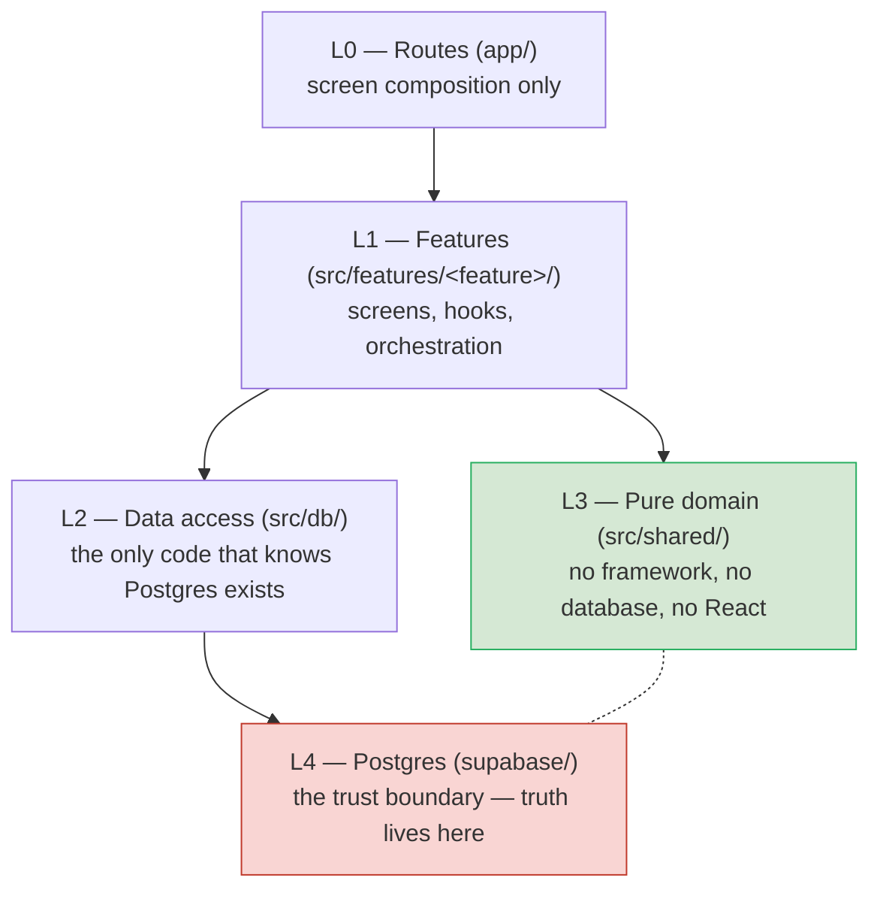

# Module View — Developer Guide

Status: agreed design, awaiting implementation. Companion to
[`REQUIREMENTS.md`](./REQUIREMENTS.md) and [`ARCHITECTURE.md`](./ARCHITECTURE.md).

**Purpose.** This document is the enforcement layer. `REQUIREMENTS.md` says what
the app must do; `ARCHITECTURE.md` says how the data is shaped; this document says
**where every piece of code lives, and what it is allowed to touch.**

A developer should be able to answer two questions from this document alone:
*"where do I put this?"* and *"why is that not allowed here?"*

> **Status note.** The project is not scaffolded yet. Every path below is the
> agreed target, not something that exists today.

---

## 1. The layering model

Four layers. Each one may only use the layer below it.



**Rules, in one place:**

| Rule | Statement |
| --- | --- |
| R1 | Arrows point down only. Nothing imports upward. |
| R2 | `src/shared/` imports **nothing** from React, Expo, or Supabase — only itself and the standard library. |
| R3 | `src/db/` is the **only** module that imports `@supabase/supabase-js`. |
| R4 | `app/` routes import only `src/features/*` and `src/ui/*`. No `src/db`, no `src/shared`. |
| R5 | A feature may not import another feature's internals. Only its public `index.ts`. |
| R6 | Business rules (invariants) live in L4. L3 holds only presentation-side logic. They must agree. |

### Why these rules exist

The expensive bugs in this product are not crashes. They are **silently wrong
numbers** and **data visible to the wrong person**. Every rule above exists to
prevent one of those:

- **R2** is what makes the money and date logic unit-testable without a phone, a
  simulator, or a database.
- **R3** means there is exactly one place to audit for the service-role key and
  session storage, instead of hunting through 40 screens.
- **R6** is the "two implementations drift" problem. A rule in exactly two
  places is strictly worse than one place plus a test that proves they agree.

---

## 2. Dependency matrix

Read as *row may import column*.

| | L0 routes | L1 features | L2 db | L3 shared | L4 supabase | ui |
|---|---|---|---|---|---|---|
| **L0 routes** | — | ✅ | ❌ | ❌ | ❌ | ✅ |
| **L1 features** | ❌ | ⚠️ public only | ✅ | ✅ | ❌ | ✅ |
| **L2 db** | ❌ | ❌ | — | ❌ | ✅ | ❌ |
| **L3 shared** | ❌ | ❌ | ❌ | ⚠️ same layer only | ❌ | ❌ |
| **L4 supabase** | ❌ | ❌ | ❌ | ❌ | — | — |

⚠️ = allowed with a restriction, explained in §6.

`src/ui/` is a leaf: the design system (buttons, inputs, progress bars, chart
primitives). It imports nothing but itself and L3 for formatting.

**Enforcement.** These are lint-checkable, not aspirational. Add
`eslint-plugin-boundaries` (or `no-restricted-imports`) with the matrix above;
the rule fails CI on violation. A module view that isn't enforced becomes
historical documentation within two sprints.

---

## 3. Module catalogue

### L0 — Routes (`app/`)

| Module | Responsibility | Must not |
| --- | --- | --- |
| `app/_layout.tsx` | Providers: QueryClient, auth gate, theme. | Contain logic. |
| `app/(onboarding)/` | Single screen, two questions. | Read the database directly. |
| `app/(tabs)/index.tsx` | This month. | Compute anything. |
| `app/(tabs)/reports.tsx` | Monthly report. | Know what a column is called. |
| `app/(tabs)/settings.tsx` | Preferences, export, delete account. | Hold the export logic itself. |
| `app/expense/[id].tsx` | Create / edit personal expense. | Validate splits. |
| `app/period/[id]/index.tsx` | Period expense list. | Decide who can delete. |
| `app/period/[id]/balances.tsx` | The balances screen. | Sum anything — call L4. |
| `app/period/[id]/budget.tsx` | Period budget progress. | Compare to a total. |

A route is a *signpost*. It maps a URL to a feature screen and nothing more.

### L1 — Features (`src/features/`)

| Module | Responsibility | Public surface |
| --- | --- | --- |
| `accounts/` | Sign up, verify, sign in, reset, sign out, delete account. | `useAuth`, `useSession` |
| `onboarding/` | Choose currency, confirm categories. | `OnboardingScreen`, `useCompleteOnboarding` |
| `categories/` | Create, rename, re-order, archive, seed on signup. | `useCategories` |
| `expenses/` | Personal expenses: list, filter, search, create, edit, delete. | `useExpenses`, `ExpenseScreen`, `useCreateExpense` |
| `periods/` | Create a period, roster, manager transfer, member list. | `usePeriod`, `usePeriods`, `PeriodScreen` |
| `splits/` | Choose participants, preview shares, validate exact amounts. *(UI for L3 logic)* | `useSplitPreview`, `SplitEditor` |
| `budgets/` | Budget create/edit and progress. | `useBudgets`, `useBudgetProgress` |
| `reports/` | Monthly totals, category breakdown, per-day. | `useMonthlyReport` |
| `export/` | CSV and JSON backup generation. | `useExportData` |

**This is the only layer with TanStack Query hooks.** That is deliberate: the
query cache is the app's view of server state, and having hooks in one layer
makes it auditable.

#### Inside a feature folder

```
src/features/<feature>/
├─ index.ts            # public surface — the only import path for outsiders
├─ screens/            # full-screen components
├─ components/         # local presentational pieces
├─ hooks/              # TanStack Query hooks: useX, useCreateX
├─ queries.ts          # query keys + read query definitions
├─ mutations.ts        # write operations, calling L2 RPCs
└─ types.ts            # feature-local view models
```

Rule R5 in practice: `src/features/periods/queries.ts` may import
`../../features/splits` but **never**
`../../features/splits/queries`. If two features genuinely need the same
capability, it belongs in `src/shared/` or `src/db/`.

### L2 — Data access (`src/db/`)

**The only layer that knows Postgres exists.** If a file mentions
`@supabase/supabase-js`, a table name, or a column name, it lives here.

| Module | Responsibility |
| --- | --- |
| `client.ts` | Creates the Supabase client. Configures secure session storage. Injects the generated types. |
| `rpc/expenses.ts` | Typed wrappers around the SQL write functions. |
| `rpc/balances.ts` | Typed wrappers around the balance and period functions. |
| `rpc/reports.ts` | Typed wrappers around aggregation views. |
| `tables/*.ts` | Raw read queries for table records (no caching, no rules). |
| `types.ts` | **Generated.** `supabase gen types typescript`. Never hand-edited. |

`src/db` holds **no validation, no business rules, and no formatting.** It
translates. A function here has one job: take a typed input, call Postgres,
return the typed result, and surface a typed error.

### L3 — Pure domain (`src/shared/`)

No React. No Expo. No Supabase. No network. Standard library only.

| Module | Responsibility | Depends on |
| --- | --- | --- |
| `money/` | Minor-unit type, parse a user's typed amount, format for display, sum a list, `allocate()` for even splits. | nothing |
| `dates/` | Month ranges **in a user's IANA zone**, DST-safe boundaries, "is this date in this period". | nothing |
| `splits/` | Freeze participant shares at creation; validate that exact shares total the expense; the deterministic remainder rule. | `money/` |
| `validation/` | Client-side mirrors of server rules, **for UX only**. Never a substitute for L4. | `money/`, `dates/` |

The `splits/` module is the one place where the same rule exists in two
languages. See §7.

### L4 — Postgres (`supabase/`)

**The trust boundary. Every invariant is enforced here or nowhere.**

| Module | Responsibility |
| --- | --- |
| `migrations/` | Ordered schema changes. One concern per file. |
| `functions/create_expense.sql` | Authorise → validate membership → validate date range → validate split total → insert. All in one transaction. |
| `functions/period_balances.sql` | Compute paid / owes / net per member. |
| `functions/expense_totals.sql` | Aggregates for reports and budgets. |
| `functions/manage_period.sql` | Create period, transfer manager, enforce "last manager cannot leave". |
| `tests/rls_test.sql` | Cross-user access must fail. |
| `tests/golden_dataset_test.sql` | Hand-computed fixtures, exact expected values. |
| `seed.sql` | Starter categories. |
| `config.toml` | Local stack configuration. |

---

## 4. Contracts

Signatures are the agreed interface. Implementations belong to the owning layer.

### `src/shared/money`

```ts
// amount: integer minor units. currency: ISO-4217.
type Minor = { minor: number; currency: string }

parseAmount(input: string, currency: string): Minor | null   // accepts "24.50", rejects "24.505"
formatAmount(amount: Minor, locale?: string): string        // "24.50"
sumAmounts(amounts: Minor[], currency: string): Minor       // throws on mixed currency

// Even split with a deterministic remainder (BR-2).
allocate(amount: Minor, participantIds: string[]): Map<string, number>
```

`allocate()` is where money bugs are born, so it is small, pure, and fully
unit-tested. No other function may implement a rounding rule — one helper, one
place, no exceptions.

### `src/shared/dates`

```ts
monthRange(anchor: Date, timeZone: string): { from: LocalDate; to: LocalDate }
isWithinPeriod(date: LocalDate, start: LocalDate, end: LocalDate | null): boolean
```

`monthRange` is the answer to "which month is this in?" It takes an IANA zone,
never UTC, and returns an inclusive range of plain dates. Callers pass the range
to L4 — they never build a date filter themselves.

### `src/shared/splits`

```ts
// Which members share, and how much each owes.
freezeShares(amount: Minor, participants: string[]): Map<string, number>
validateExactShares(amount: Minor, shares: Map<string, number>): string | null
```

`freezeShares` is the even split. `validateExactShares` checks that manual
amounts are non-negative and total exactly the expense amount.

### `src/db/rpc`

```ts
createExpense(input: CreateExpenseInput): Promise<Result<string>>    // returns new id
expenseTotals(scope: Scope, range: DateRange): Promise<Report>
periodBalances(periodId: string): Promise<MemberBalance[]>
createPeriod(input: CreatePeriodInput): Promise<Result<string>>
transferManager(periodId: string, newManagerId: string): Promise<Result<void>>
deleteAccount(): Promise<Result<void>>
exportUsersData(range: DateRange): Promise<Backup>
```

Every write returns a typed `Result`. Failures are never thrown past the hook,
never swallowed, and never represented as a silent empty list.

### Conventions

- **Query keys** are namespaced per feature: `['expenses', userId, range]`,
  `['period', id, 'balances']`. One key per distinct server response.
- **Mutations invalidate** the queries that depend on them. Creating an expense
  invalidates both the expense list and the period balances.
- **Nothing is mirrored.** After a write you invalidate; you do not poke the
  cache by hand to make it "look right".

---

## 5. Tracing the three core flows

A developer who can read these three traces understands the system.

### 5.1 Record a personal expense

```
app/expense/new                       # L0: collect nothing, render a screen
  → features/expenses/screens/NewExpenseScreen
      → shared/money.parseAmount      # L3: "24.50" → {minor: 2450} — instant, local
      → features/expenses/mutations.useCreateExpense
          → db/rpc/expenses.createExpense      # L2 → L4
              → supabase.functions.create_expense
                    · authorise: caller is the owner
                    · amount > 0, currency matches profile
                    · date is not in the future
                    · insert expense + exactly one split row (owner, full amount)
                    · return id
          ← Result<id>
      → invalidate ['expenses', userId, month]
  → features/expenses/screens renders the updated month
```

**Notice what does not happen.** The screen never computes a total, never decides
whether the amount is valid, and never inserts a row. It types a number and
hands it down.

### 5.2 Record a shared expense with an unequal split

```
app/period/[id]/new
  → features/periods/.../NewSharedExpenseScreen
      → features/splits/useSplitPreview
          → shared/splits.freezeShares or validateExactShares   # L3, local, instant
          ⤷ screen shows each member's share before the user saves (FR-5.5)
      → features/expenses/mutations.useCreateExpense
          → db/rpc/expenses.createExpense
              → create_expense
                    · caller is a member of the period
                    · date within [starts_on, ends_on]   ← reject, never clamp
                    · every participant is a period member
                    · every share ≥ 0 AND SUM(shares) == amount
                    · insert expense + one split row per participant
  → invalidate expenses for the period AND period balances
```

The preview runs locally so typing feels instant. **The server does not trust
it.** `create_expense` re-derives and re-validates everything, and a mismatch is
rejected, not corrected.

### 5.3 Show period balances

```
app/period/[id]/balances
  → features/periods/screens/BalancesScreen
      → features/periods/queries usePeriodBalances
          → db/rpc/balances.periodBalances     # L2 → L4
              → period_balances(period_id)
                    paid  = Σ amount_minor where paid_by = m, not deleted
                    owes  = Σ split.amount_minor where split.user_id = m, not deleted
                    net   = paid − owes
      → features/periods/components/BalanceRow renders
```

**There is no addition in this flow.** No screen sums anything, no hook
aggregates anything. The SQL returns final numbers, and the phone renders them.

---

## 6. Cross-cutting concerns

### Authentication

`src/features/accounts/` owns the session and exposes `useSession`. `src/db/client.ts`
is the only place the session is read or written. Screens ask a hook, never a
store.

### ⚠️ Clearing state on sign-out — a privacy bug waiting to happen

When a user signs out, or switches accounts, the **TanStack Query cache must be
cleared in full**. If it isn't, a cached `['expenses', userId, range]` entry and
its rendered screen survive into the next session, and the next user sees the
previous user's financial data for as long as the cache entry lives.

This is the one failure mode in the app that leaks another person's data without
RLS failing at all — RLS blocks the *database* read, but the cache is outside it.

**Required behaviour:** sign-out clears the query cache, resets all feature
stores, and navigates through a full unmount of the authenticated tree. Same for
a 401 or session-expiry response from any RPC.

> **Recommendation:** promote this to a hard rule in `AGENTS.md` and add the
> matching case to the RLS/integration suite. It is a missing precondition, not
> an implementation detail.

### Offline and degraded reads

| State | Reads | Writes |
| --- | --- | --- |
| Online | Normal. | Normal. |
| Offline | Serve cache, banner "showing data from *time*". | Fail with a clear message. Never queue. |

There is no local database in v1. The cache is the only offline artifact, and
it is allowed to be stale as long as the app *says* it is stale.

### Error surfacing

| Origin | Where it is handled | What the user sees |
| --- | --- | --- |
| Split doesn't total the amount | L3, before submit | Inline message on the field. **The save button is disabled.** |
| Expense dated outside the period | L4, on submit | Banner: "Pick a date inside the period." |
| Date moved by a timezone edge case | L4, on submit | Banner with the accepted range, not a crash. |
| No connection | Hook, before the call | "You're offline — reconnect to save." |
| Not authorised | L4, RLS or the write function | Treated as "not found": never reveal that a record exists. |

**RLS denials must be indistinguishable from "does not exist."** That is
deliberate — the alternative tells an attacker which IDs are real.

---

## 7. Where invariants are enforced and tested

The most valuable table in this document. When a developer asks *"where does
this rule live?"*, this is the answer.

| Invariant | Enforced in | Tested by |
| --- | --- | --- |
| Amounts are integer minor units | `shared/money` types + schema columns | Unit: money suite |
| No negative amounts | `CHECK` + `create_expense` | pgTAP |
| Dates are plain `date`, no timezone | Schema | Golden dataset |
| Month boundaries never in UTC | `shared/dates` + callers passing `(from, to)` | Unit: DST case in dates suite |
| Split shares sum to the expense | `create_expense` | pgTAP conformance fixtures |
| Splits frozen at creation | Schema: computed columns, stored values | Golden dataset (roster change) |
| Participants must be period members | `create_expense` | pgTAP |
| Expense date inside the period range | `create_expense` | pgTAP |
| Deterministic rounding remainder | SQL **and** `shared/splits` | Conformance fixtures in **both** suites |
| Exactly one manager per period | Partial unique index | pgTAP |
| The last manager cannot leave | `manage_period` | pgTAP |
| No user can see another's data | RLS on every table | RLS suite (outsider reads zero rows) |
| Balances are computed, never stored | `period_balances` only | Golden dataset (edit, delete, re-add) |
| Personal and shared money never merge | Report/budget scopes | Golden dataset |
| Budgets are advisory, never blocking | No write path calls a budget check | Unit |
| Cache cleared on sign-out | `accounts` | *⚠️ To be added — see §6* |

---

## 8. The split-rounding duplication (open decision)

The rounding rule (`BR-2`) must exist in two places: SQL, because the server
validates; and `shared/splits`, because the preview must be instant while
typing. **Two implementations of a rounding rule will drift.**

This is still undecided — see `AGENTS.md`, Open decisions. The module view
assumes option A:

**A. Keep both, with a shared conformance fixture.**
`shared/splits/freezeShares` handles previews; SQL is authoritative; one JSON
fixture drives assertions in both the Jest and pgTAP suites, so drift fails CI.

**B. SQL only.** The screen calls an RPC for a live preview, so `shared/splits`
does not exist. Modules affected: `shared/splits/*` deleted, the split editor
gains a loading state, and one round-trip per keystroke continues.

> Modules affected by reversing this: `shared/splits/`, `features/splits/`,
> and one entry in the ENFORCED column of §7.

---

## 9. Anti-patterns

Named, concrete, with the reason. If a code review sees one of these, it is not
a matter of taste.

1. **Summing in a hook.** `const total = expenses.reduce((a, e) => a + e.amount, 0)`
   in a screen or hook. The database already knows this number, knows the scope
   rules, and applies the same `deleted_at` filter. Recomputing it here creates a
   second, subtly different answer.
2. **A balance table that is updated on write.** It drifts, permanently, the
   first time a transaction rolls back. Balances are computed.
3. **Importing `@supabase/supabase-js` in a component.** It breaches R3, and the
   service-role key becomes one careless import away from shipping.
4. **`import { X } from '../../features/periods/queries'`.** Breaches R5. Two
   features are now coupled at the file level, and renaming an internal breaks
   the other one.
5. **Client-side validation as the only validation.** `validateExactShares` is
   a courtesy to the user. The server re-runs it identically and rejects a
   mismatch.
6. **Filtering `deleted_at` in some screens and not others.** Deleted expenses
   reappear in whichever screen forgot, and they reappear in the totals. Filter
   in one place, and prefer a view that has already filtered them.
7. **A `useEffect` that populates form state from a query.** Mirroring server
   data into local state is the duplicated-cache bug. Read from the query.
8. **An "amount typed by the user goes straight to the screen" number.** Every
   amount crossing a boundary is `{minor, currency}`, not a bare number.
9. **`moment` / `date-fns-tz` / a hand-rolled offset** installed to fix one date
   bug. Month ranges come from the `timeZone` database column, via `monthRange`.
10. **Hand-editing `src/db/types.ts` to make an error go away.** It is generated.
    Fix the schema, regenerate, commit.

---

## 10. Implementation order

A developer starting cold should build in this order. Each step is shippable and
testable at the boundary.

1. **L4 first.** Schema, RLS policies, `create_expense`, `period_balances`,
   `expense_totals`, `manage_period`. Write `rls_test.sql` and the golden
   dataset *before* any screen exists.
2. **L3.** `money`, `dates`, `splits` with unit tests. Pure and fast, no
   scaffolding required.
3. **L2.** Generate types, write the RPC wrappers.
4. **`accounts` feature**, so there is something to log into.
5. **`categories` + seeding**, so an expense can be recorded.
6. **`expenses`** — the core loop.
7. **`periods` + `splits`** — the shared case.
8. **`reports` + `budgets`** — once real numbers exist to report.
9. **`export`** — portability, once the data model is stable.
10. **`onboarding`** — last, because it is the only part that can look finished
    while hiding an unfinished app.

Writing L4 before L0 is deliberate: the RLS suite and golden dataset are what
prove the app is safe, and both are impossible to write against a UI that does
not exist yet.
